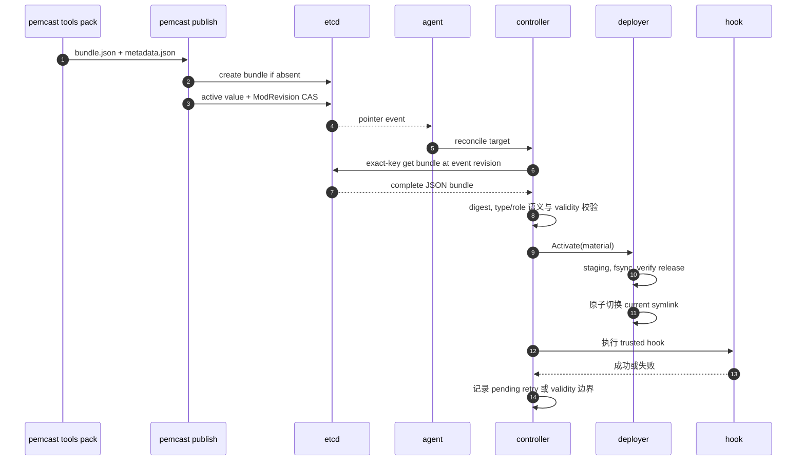

# pemcast v6 架构

## 定位

pemcast 是一个 pull-only certificate agent 与 staged publisher. `pemcast tools pack` 在本地校验证书并生成 immutable v6 bundle 与 metadata; `pemcast publish` 先 stage bundle, 再用 active pointer 的 value + ModRevision CAS 提交发布. agent 只监听 active pointer, 按事件 revision exact-key 读取 bundle, 校验后在本地物化 immutable release 并切换稳定 symlink. 服务重载交给可信 hook.

仓库不包含 etcd lease manager, service-control integration 或 HTTP API. etcdctl helper 位于 repo-deployment skill, 仅作为手动 fallback; 产品发布路径是单一 `pemcast publish --pack-dir`, 不存在 v4 plan/apply/activate 状态机. 顶层 `pemcast upgrade` 只提供 canonical v5 active 数据到 v6 的一次式迁移.

`pemcast tools seed` 可以在首装或显式救援时离线物化同一个 deterministic release, 但不读写远端 pointer 或 agent state.

## 运行流程

启动时校验配置. 非 dry-run agent 按排序获取每个 output root 的排他文件锁. 单 tenant 配置构造一个 etcd client; `agent.etcds[]` 配置为每个 tenant 构造独立 etcd client, snapshot/watch session 与 reconcile controller, 并在同一个进程中并发运行. 所有 controller 共享全局 `agent.max-concurrent` 信号量. dry-run 不获取 output root 锁.

publish, upgrade 与 prune 是单 etcd 管理命令. 它们从同一个 `agent.etcds[]` 数组选择连接: 未显式指定时优先选择 `name: default`, 否则选择第一个 entry. `user` 仅供 agent watcher 使用, `management-user` 供管理命令使用, 后者为空时保留命令特定环境凭据 fallback.

`agent --once` 一次 range read 读取 active prefix 下全部 pointer, 得到同一个 revision 的 snapshot, 然后 reconcile 配置 target 的交集. 普通 agent 循环执行:

1. 用短生命周期 etcd client range read active prefix, 记录 etcd revision.
2. 并发 reconcile snapshot; unchanged release 也会执行一次幂等 hook.
3. 从 `snapshot.Revision` 起监听 active prefix, 并丢弃 `revision <= snapshot.Revision` 的重复事件, 因此有效事件边界仍是 snapshot 之后的 revision.
4. 处理 pointer put/delete; bundle stage 不产生 watch 事件.
5. 长驻 watcher 按 `progress-interval` 发送 manual progress request.
6. 超过 `progress-timeout` 没有 event/progress, 或 watch 返回协议错误时, 放弃该 etcd 的 session 并从新 snapshot 重启.
7. 每个 etcd 的 snapshot/watch 失败使用独立有界指数退避和 jitter 重试, 不阻止其他 etcd.

watch 模式中单个 reconcile 失败只记录日志, 不停止进程.
snapshot 与 exact bundle read 使用短生命周期 etcd client, 避免空闲后复用过期 auth token; 长驻 client 只承担 watch stream, 断线重建 stream 时由官方 client 重新认证.



## v6 远端模型

etcd namespace prefix 可配置, 默认 `/pemcast`. 固定子协议是 `/v6`:

```text
<etcd-prefix>/v6/active/<target-id> = <generation>
<etcd-prefix>/v6/bundles/<target-id>/<generation> = <complete JSON bundle>
```

bundle 是单 key JSON, 文件内容 base64 内联:

```json
{
  "schema": "pemcast/v6",
  "type": "tls-server",
  "files": [
    {
      "name": "fullchain.pem",
      "role": "certificate-chain",
      "sha256": "<lowercase sha256>",
      "encoding": "base64",
      "data": "..."
    },
    {
      "name": "privkey.pem",
      "role": "private-key",
      "sha256": "<lowercase sha256>",
      "encoding": "base64",
      "data": "..."
    }
  ]
}
```

约束:

- target ID 和 generation 必须是单个安全 path component, 最长 128 bytes.
- `type` 只能是 `tls-server`, `tls-client` 或 `trust`.
- identity bundle 必须恰好包含 `fullchain.pem` 和 `privkey.pem`; trust bundle 必须恰好包含 `ca-bundle.pem` 且没有私钥.
- `role` 只能是与 type 匹配的 `certificate-chain`, `private-key` 或 `ca-certificate`.
- `encoding` 只能是 `base64`.
- JSON 严格拒绝 unknown member.
- 每个 file 的 SHA-256 必须匹配原始 bytes, 不是 base64 文本.
- identity bundle 会解析整条 PEM chain, 校验 leaf-first 签名顺序, leaf/key 匹配, 算法和 EKU; trust bundle 中每张证书必须是 CA.
- 完整 encoded bundle 最大 1 MiB.
- bundle fetch 使用 exact key, 不接受 generation prefix 或额外 key.

whole-bundle digest 按 bundle type 和排序后的文件名, 语义 role 与原始内容 SHA-256 计算:

```text
SHA256(
  "pemcast/v6" + NUL + bundle-type + NUL +
  for each sorted file: name + NUL + role + NUL + SHA256(raw content)
)
```

generation 固定为:

```text
sha256-<whole-bundle-digest>
```

agent 会拒绝 pointer generation 与 bundle digest 不一致的数据.

## 分阶段发布

`pemcast tools pack` 只读取本地证书材料, 不访问 etcd. 它输出:

- `bundle.json`: canonical deterministic complete JSON bundle.
- `metadata.json`: schema, prefix, target, generation, keys, encoded size, encoded bundle hash 和每个源文件 hash; 不包含私钥内容.
- `stage.txn`: etcdctl transaction, 仅当 bundle key 不存在时写入 exact bundle bytes.

发布分两步:

1. Stage immutable bundle. bundle key 不存在则创建; 已存在则要求 encoded bytes 完全相同. 任何差异都是数据损坏并必须失败.
2. Capture active pointer 的 generation 和 ModRevision, 再用 etcd transaction CAS pointer. 首次发布条件是 `create(active) = 0`; 更新条件是 active value 和 ModRevision 都匹配.

`pemcast publish` 读取 pack 后会独立重算 encoded bundle hash, file hash, semantic whole digest, generation 和证书语义, 并拒绝 metadata keys 与当前 etcd prefix 不一致. 手动 `publish-v6.sh` 维护同一不变量, 但它不是产品镜像的一部分.

v6 允许存在未被 active pointer 引用的孤儿 bundle. 这是设计结果, 不是失败: bundle 是 object database, active pointer 是 ref. 消费者只 watch active prefix, 因此 bundle stage 本身没有发布语义. 唯一 commit point 是 pointer CAS 成功.

etcd CAS transaction 的 success response 是 publish 的权威提交判定. CAS 成功后, 另一个合法发布可能立即覆盖 active pointer; 这不会使先前的成功发布变成失败.

发布失败或并发冲突时可能留下已 stage 的 bundle, 可以保留给后续重试或由 `pemcast prune` 清理. active generation 对应的 bundle 必须永远保留.

## 历史 bundle 清理

`pemcast prune --dry-run` 是纯读操作. 它扫描一个 prefix 的 bundle keys, 逐个 exact-key 读取并完整验证 bundle, 然后报告 lifecycle 决策:

1. active generation 永不删除.
2. `trust` bundle 不按证书 `NotAfter` 自动判断, 跳过.
3. target 缺少 active pointer 时跳过, 要求人工确认.
4. identity bundle 取证书链中最早的 `NotAfter`, 再应用配置的 retention.
5. 只有非 active 且已经超过 `earliest_not_after + retention` 的 identity bundle 才 eligible.
6. `--delete` 对每个 candidate 使用 exact bundle key 删除, transaction 同时确认该 target active pointer 的 value 和 ModRevision 未变化.
7. malformed 或 generation/digest 不一致的 bundle 使 prune 失败, 不自动删除.

该设计不使用 etcd lease: bundle 单独过期会造成 dangling pointer, pointer 与 bundle 一起过期会破坏 active generation 必须保留的不变量. 证书 artifact 是独立的重放和排障通道, 其保留策略不由远端 bundle prune 决定.

## v5 到 v6 upgrade

`pemcast upgrade --dry-run` 是纯读操作. 实际迁移按 target 独立提交:

1. Snapshot v5/v6 active prefix, 拒绝 v4, 空 v5, 无对应 v5 target 的 v6 active 或 divergent v6 active.
2. 按 v5 snapshot revision exact-key 读取每个 active bundle.
3. 用 v5 historical digest 和 canonical file set 验证 source.
4. 根据操作者显式声明的 `tls-server` 或 `tls-client` 重建 v6 bundle.
5. Stage destination immutable bundle.
6. 在 source v5 pointer value + ModRevision 未变化且 destination pointer 仍不存在的条件下 CAS 写入 v6 pointer.
7. 全部 target postverify 通过后, 才允许显式删除精确的 `<prefix>/v5/` prefix.

v5 generation 不会推导 v6 generation; upgrade 从原始材料重建 v6 semantic digest. 默认保留 v5. 删除前必须停止旧 v5 publisher; 旧 v5 watcher 收到 delete event 后不会自动切到 v6.

## Reconcile

每个 target:

1. 用进程内 mutex 串行化同 target.
2. 获取全局 concurrency slot.
3. 按事件 revision exact-key 获取 bundle.
4. 校验 generation/digest, target type, identity 链/key/EKU 或 trust CA-only 语义, 以及 validity/SAN policy.
5. dry-run 在任何本地访问前停止.
6. 通过 deployer 读取并校验本地 current release; digest 相同则完整复核 mapped bytes, modes 与目录树.
7. 只在本地 selected digest 不同 时创建 immutable release 并原子切换 symlink.
8. 激活后执行 hook; 失败时保留已验证 material 与 event, 由独立指数退避重试.
9. 记录证书时间元数据, 在 minimum-validity 或 expiry 边界本机告警, 不制造远端请求.

不同 target 可以并发. snapshot 缺失 target 时按 `delete-policy` 处理: `retain` 保留本地文件并记录日志, `fail` 返回错误. agent 不自动删除本地 target.

## 本地启用

```text
/etc/nginx/tls/
├── current -> .pemcast/releases/sha256-<digest>
├── .pemcast/agent.lock
└── .pemcast/releases/
    ├── sha256-old/
    └── sha256-active/
```

release 先写入 staging directory, 内部固定使用协议 bundle 文件名和 role mode, 写入 `.pemcast-digest`, fsync, rename 到最终 immutable 目录, 再用临时 symlink 原子切换. 复用已有 release 时校验 digest marker, release file bytes, modes 和完整目录树. active release 永不 prune.

远端 generation 和本地 release 都由 digest 推导, 因此相同内容不会产生重复 release.

#### Public role aliases

`output.files` 按 bundle role 配置 public 文件名和 mode. 省略时由 target type 推导:

- identity: `fullchain.pem` mode `0644`, `privkey.pem` mode `0600`.
- trust: `ca-bundle.pem` mode `0644`.

deployer 为 output root 下每个 role 维护一个文件级 symlink:

```text
/etc/nginx/tls/
├── fullchain.pem -> current/fullchain.pem
└── privkey.pem -> current/privkey.pem
```

目录级 symlink 切换在 inotify 中不产生 role file 的事件, fsnotify 型消费者 (sing-box, Traefik, Envoy file-based SDS) 无法通过 `current/...` 路径检测更新. generation 变化时, 根级 role alias 会被强制 tmp+rename 替换, 即使 link 字符串仍是 `current/<bundle-file>`; 这会在 output root (真实目录) 内产生 Create 事件, 使这些消费者直接热加载, 不再需要复制文件的 hook. generation 未变化时, 已存在且 target 正确的 link 不会被重复替换, 因此不产生多余事件.

public name 必须是安全文件名, 不能使用子目录, `current` 或 `.pemcast`. 这保证每个 role 都具备同样的根级通知能力; 需要子目录布局的消费者应挂载到自己的 output root, 或配置独立 target.

配置改名后, 部署器只清理确认指向 `current/...` 或 `.pemcast/...` 的旧受管 alias. output root 中出现其他非受管文件时激活失败, 不做猜测性删除.

消费者按自身重载机制选择路径:

| 消费者类型 | 推荐路径 | 原因 |
|---|---|---|
| fsnotify 型 | 根级 `fullchain.pem` | symlink 替换触发 Create 事件 |
| 每次握手读取型 | `current/fullchain.pem` 或根级 | 两者等价 |
| 信号或重启型 | 任一路径 | hook 负责通知, 文件路径无关 |

### 容器与多消费者边界

output root 是 node-local managed volume. pemcast agent 是该 volume 的唯一 writer, 应用容器是 reader. 应用必须挂载 output root 本身, 然后读取 `current/...`; 不能挂载 `current`, `current` 下的单个文件, 或使用 Kubernetes subPath 指向 `current`. 否则 container runtime 可能在启动时固定旧 release, 后续 symlink 切换无法反映到容器内.

同一台设备上的多个应用容器可以共享同一个 output root. 它们都只读挂载 root, 并由一个本机 fan-out hook 依次重载. 如果不同消费者需要不同权限或不同重载策略, 应配置成不同 target 和不同 output root.

hook 是本机服务控制适配器, 不是远端状态回报机制. 它必须运行在有权限控制目标服务的 namespace 中. host-level agent 可以直接调用 systemd, Docker 或 Podman; node agent container 需要显式挂载 hook 和对应 runtime 控制接口.

## Hook

hook 直接执行, 不经过 shell. 它获得固定 `PATH`, 显式放行环境变量和 `PEMCAST_*` event 变量, 并从 stdin 读取 JSON. timeout 时终止整个 process group. 失败输出在收集阶段限制为 4096 bytes.

hook 在 symlink 切换后执行. 失败记录在进程内 pending hook 状态; 后续独立重试会先复核本地 release, 再执行 hook, 不重写未变化 release. hook 必须幂等. agent 重启后内存 hook error 丢失, 但启动 snapshot 会对 unchanged release 重新执行 hook. 本地没有 state 文件; output root 文件系统是唯一 truth.


## 包地图

- `cmd/pemcast`: CLI 入口和 signal context.
- `internal/appcmd/agent`: application 组装, 单/多 etcd runtime, output lock 与 once/watch 生命周期.
- `internal/appcmd/config`: config example 和校验命令.
- `internal/appcmd/tools/pack`: local pack CLI adapter.
- `internal/appcmd/publish`: v6 staged publication CLI adapter.
- `internal/appcmd/upgrade`: v5-to-v6 prefix migration CLI adapter.
- `internal/appcmd/tools/seed`: 本地 seed CLI adapter.
- `internal/appcmd/status`: 本地状态 CLI.
- `internal/config`: schema, defaults, validation 和 cfgm 集成.
- `internal/keyspace`: 可配置 etcd namespace prefix 与固定 `/v6` key builder.
- `internal/etcdsource`: active-prefix snapshot/watch, watch progress session 和 exact bundle fetch.
- `internal/bundle`: v6 单 key manifest, digest, generation 和 TLS 校验.
- `internal/pack`: local TLS 校验, deterministic bundle, metadata 和 stage transaction 生成.
- `internal/publisher`: v6 pack 的 immutable staging 与 active pointer CAS 状态机.
- `internal/upgrade`: v5-to-v6 snapshot, preflight, source-aware staged commit, postverify 和 optional old-prefix cleanup.
- `internal/upgrade/legacy`: 当前二进制的 canonical v5 decoder/converter; v6-to-v7 一次性二进制直接替换为 v6 decoder/converter.
- `internal/prune`: 非 active identity bundle 的过期报告, retention 判断和条件 exact-key 清理.
- `internal/seed`: 从已验证 v6 pack 离线构建本地 release 的首装与显式救援命令.
- `internal/reconcile`: orchestration, lock, concurrency 和 hook retry.
- `internal/deploy`: output root lock, release 完整性, 原子 symlink, prune 和 fsync.
- `internal/hook`: process group, 环境边界, 输出限额和 event schema.
- `internal/status`: 只读本地 target 状态.
- `.agents/skills/repo-deployment/scripts/publish-v6.sh`: 手动 etcdctl staged publication fallback.
- `scripts/integration-etcd.sh`: 真实 etcd 3.7.2 auth/RBAC/publish/agent 集成测试.
- `scripts/integration-etcd-seed.sh`: 真实 TLS etcd 的 seed 首装, watch 更新和显式救援集成测试.
- `scripts/integration-etcd-upgrade.sh`: 真实 etcd 的 v5-to-v6 upgrade, agent 验证和 old-prefix cleanup 集成测试.
- `scripts/integration-etcd-prune.sh`: 真实 etcd 的 prune dry-run, 条件删除, active/trust 保护和 agent 健康集成测试.

真实 etcd 集成测试覆盖 auth token 过期后的空闲 watch: agent 跨多个 token TTL 后仍收到 pointer event, 且 watch 日志不出现 `invalid auth token`.
