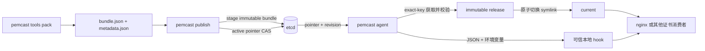

# pemcast

pemcast 是一个从 etcd 拉取 TLS 证书的本地 agent, 同时提供 v6 staged publisher. `pemcast tools pack` 从证书内容计算 content-addressed generation, 并生成 deterministic bundle 与 metadata; `pemcast publish` 先 stage immutable bundle, 再用 active pointer 的 value + ModRevision CAS 提交发布. pemcast agent 监听指针变化, 按事件 revision 取回 bundle, 校验 SHA-256 与 `tls-server` / `tls-client` / `trust` 三种语义, 然后在本地生成不可变 release 并原子切换 `current` symlink. 应用始终读取稳定路径, hook 在切换成功后触发服务重载.



## 设计要点

- 证书发布者与消费者解耦: pemcast 不包含签发, 审批, lease manager 或 HTTP API.
- 远端 generation 内容寻址: generation 由完整 bundle digest 计算, 相同内容天然相同, 内容变化必然得到新名字.
- 发布分阶段: bundle 是 immutable object database, active pointer 是 ref; bundle 先 stage, pointer CAS 是唯一 commit point.
- v5 到 v6 升级显式分步: 只迁移 active v5 数据, destination bundle 先 stage, source v5 pointer 的 value + ModRevision 参与 destination CAS.
- 并发安全: 首次发布比较 create revision, 更新比较 active value + ModRevision; 冲突失败而不是覆盖.
- 校验发生在启用前: manifest 严格解析, 文件逐一校验 SHA-256; identity bundle 校验链顺序, EKU 和证书/私钥匹配, trust bundle 校验全部证书都是 CA, 并满足有效期策略.
- 本地发布内容寻址: release 目录名来自 bundle digest, 相同内容不会重复写入; 复用前校验 marker, bytes, mode 和目录树.
- 应用路径稳定: release 内部使用 bundle 文件名, `output.files` 为每个 role 维护根级 public alias; pemcast 通过临时 symlink 和 rename 原子切换.
- output root 互斥: 非 dry-run agent 按排序获取每个 root 的 `.pemcast/agent.lock`, 并持有到进程退出.
- 非 dry-run agent 自动创建 mode `0700` 的 output root 与 `.pemcast`; dry-run 不创建任何本地目录.
- dry-run 无本地写入: 不创建 output root, 不读写本地状态, 不执行 deploy 或 hook.
- 服务重载可重试: hook 在本地切换后执行, 失败保存在进程内 pending 状态, 由独立指数退避重试.
- watch 是事件主通道: agent 长驻 active-prefix watcher, 周期发送 manual progress request, 只有 liveness timeout 或协议错误才重建 snapshot/watch.
- etcd 认证不耦合 token TTL: 稀有的 snapshot 与 exact bundle read 使用短生命周期 client; 长驻 watcher 只承担 watch stream.

## 快速上手

生成并修改 agent 配置:

```bash
pemcast config example > config/config.yaml
pemcast --config config/config.yaml config validate
```

至少配置一个 `agent.etcds[]` entry 和一个 target 的 `etcd`, `type`, `output.root` 与 hook. `output.files`, `delete-policy` 和 `validation` 都可以省略. 常用 type 是 `tls-server`, `tls-client` 和 `trust`.

### Role-based output

`target.type` 已经决定远端 bundle role, 因此本地输出按 role 覆盖, 不再配置 remote-to-local mappings:

```yaml
targets:
  - id: nginx
    etcd: default
    type: tls-server
    output:
      root: /var/lib/pemcast/nginx
      files:
        certificate-chain:
          name: tls.crt
          mode: "0644"
        private-key:
          name: tls.key
          mode: "0600"
```

省略 `files` 时:

| type | 默认 public files |
|---|---|
| `tls-server` / `tls-client` | `fullchain.pem` mode `0644`, `privkey.pem` mode `0600` |
| `trust` | `ca-bundle.pem` mode `0644` |

`name` 必须是 output root 下的安全文件名, 不能使用子目录, `current` 或 `.pemcast`. 不同 role 的 name 不能重复. release 内部始终使用协议 bundle 文件名; 用户配置的 name 只影响 output root 下的稳定 symlink.

### Target 安全默认值

省略 `delete-policy` 时使用 `retain`; 省略 `validation` 时拒绝过期证书, 并要求剩余有效期至少 `336h`. 需要更短的测试窗口时显式配置:

```yaml
validation:
  minimum-validity: 1h
```

过期证书始终拒绝, 不提供配置开关. `minimum-validity` 只影响未过期证书的剩余时间下限.

每个 `agent.etcds[]` entry 直接平级配置 `name`, `prefix`, `endpoints`, authentication 和 TLS. pack CLI 通过 `--etcd-prefix` 配置. 程序只硬编码 `/v6` 子协议:

```text
/pemcast/v6/active/nginx = sha256-<bundle-digest>
/pemcast/v6/bundles/nginx/sha256-<bundle-digest> = complete JSON bundle
```

`agent.etcds[].endpoints` 是逗号分隔的字符串, 默认 source 使用 `${ETCDCTL_ENDPOINTS}` 展开. etcd 认证使用单个 `username:password` 值, 按第一个冒号切分, 密码可以继续包含冒号; 默认 source 的 `user` 与 `management-user` 都使用 `${ETCDCTL_USER}` 展开, 为空表示匿名访问. 多 tenant source 应显式覆盖为自己的 agent 与管理凭据. 包含凭据的配置文件必须具有最小权限, 并纳入与私钥相同的 secret 管理边界.

本地打包:

```bash
pemcast tools pack \
  --type tls-server \
  --etcd-prefix /pemcast \
  --target nginx \
  --certificate fullchain.pem \
  --private-key privkey.pem \
  --output-dir /secure/tmp/nginx-pack
```

`tls-client` 使用相同的 `--certificate` 和 `--private-key` 输入, 但会按 clientAuth 用途校验. `trust` 使用 `--ca ca-bundle.pem`, 只分发 CA trust bundle, 不包含私钥:

```bash
pemcast tools pack \
  --type trust \
  --etcd-prefix /pemcast \
  --target internal-ca \
  --ca ca-bundle.pem \
  --output-dir /secure/tmp/internal-ca-pack
```

输出文件是:

```text
/secure/tmp/nginx-pack/
├── bundle.json
├── metadata.json
└── stage.txn
```

三种常用 type 的使用场景:

- `tls-server`: Nginx, Envoy, HAProxy, etcd server, HTTPS API 和 gRPC server 的服务端身份.
- `tls-client`: etcd client mTLS, PostgreSQL/MySQL mTLS 和服务间 mTLS 的客户端身份.
- `trust`: 应用信任内部 CA 的 `ca-bundle.pem`; 它没有私钥, 也不用于 pemcast 自身连接 etcd 的 bootstrap CA.

`pack` 不访问 etcd. identity bundle 的 `bundle.json` 与 `stage.txn` 包含私钥, 文件权限为 0600; pack 目录只能保存在受限存储中.

### 单进程多 tenant agent

`agent.targets[].id` 保持为远端协议 target ID. 当一个设备需要消费多个 etcd tenant 时, 为 tenant 定义 agent-local etcd name, 并在 target 上显式引用它:

```yaml
agent:
  etcds:
    - name: bendian
      endpoints: https://etcd.example:2379
      prefix: /pemcast/tenants/bendian
      user: agent-bendian:password
      management-user: publisher-bendian:password
    - name: lwmacct
      endpoints: https://etcd.example:2379
      prefix: /pemcast/tenants/lwmacct
      user: agent-lwmacct:password
      management-user: publisher-lwmacct:password
  targets:
    - id: kuaicdn.cn
      etcd: bendian
      # ...
    - id: lwmacct.com
      etcd: lwmacct
      # ...
```

每个 etcd 拥有独立 client, snapshot/watch session 和重试状态; 所有 output root 仍由同一个进程按排序加锁, `agent.max-concurrent` 是全局并发上限. 不同 etcd 下的 target ID 可以相同, 因为它们属于不同远端 namespace.

publish, upgrade 与 prune 不再维护独立 management 配置. 它们通过必填 `--etcd-name <name>` 从 `agent.etcds[]` 选择连接, 并使用该 entry 的 `management-user`.

### 本地 seed

`seed` 用于自引用消费者的首装和显式救援. 它读取一个完整 v6 pack, 按 agent 配置中的 target 校验 prefix, target, type, digest, 证书语义, output role 和有效期, 然后在不访问 etcd 的情况下创建本地 content-addressed release 并原子切换 `current`:

```bash
pemcast \
  --config config/config.yaml \
  tools \
  seed \
  --target nginx \
  --pack-dir /secure/tmp/nginx-pack
```

seed 不写本地运行状态, 也不改变远端 active pointer. 这允许先为 etcd 准备证书目录, 再启动 etcd 与 agent. agent 看到远端 pointer 缺失且使用默认 retain 行为时, 会保留本地 release 并继续 watch.

如果本地 `current` 已经指向另一个 digest, seed 默认拒绝. 只在明确的人工救援场景使用:

```bash
pemcast \
  --config config/config.yaml \
  tools \
  seed --force \
  --target nginx \
  --pack-dir /secure/tmp/nginx-rescue-pack
```

`--force` 只允许替换已存在的不同本地 release, 不跳过 pack 校验, target 校验或 TLS 校验. 运行中的 agent 持有 output root lock, 因此救援时应先停止 agent, seed 后完成远端 publish, 再启动 agent.

使用 native publish 发布:

```bash
pemcast --config config/config.yaml publish \
  --etcd-name bendian \
  --pack-dir /secure/tmp/nginx-pack
```

publish 读取 pack 后独立重算 encoded hash, 文件 hash, semantic whole digest, generation 和证书语义. 如果 bundle key 已存在, 必须与本地 `bundle.json` bytes 完全相同. 然后捕获 active pointer, 首次发布用 `create(active) = 0` CAS, 更新用 active value + ModRevision CAS. active 已经等于目标 generation 时直接 no-op. etcd transaction 成功即表示本次发布已提交; 若随后被另一个合法发布覆盖, 本次结果仍是 published.

bundle stage 可能留下未被引用的孤儿 bundle; 这不产生消费者事件, 也不会改变本地证书. 只有 pointer CAS 成功才是发布 commit point.

### 历史 bundle 清理

`pemcast prune` 用于观察或清理已经失去回滚价值的非 active identity bundle. 它不使用 etcd lease, 不修改 active pointer, 也不清理本地 release, state 或 Docker image.

先执行纯读报告:

```bash
pemcast --config config/config.yaml prune \
  --etcd-name example \
  --retention 720h \
  --dry-run
```

`--retention 720h` 表示 identity chain 中最早过期的证书再保留 30 天. 未过期, 尚在宽限期内, active, trust 和没有 active pointer 的 target 都不会删除.

确认报告后显式执行:

```bash
pemcast --config config/config.yaml prune \
  --etcd-name example \
  --retention 720h \
  --delete
```

清理规则:

- active generation 永不删除.
- 只处理 `tls-server` 和 `tls-client` identity bundle.
- `trust` bundle 不按证书 `NotAfter` 自动判断, 默认跳过.
- bundle 的最早 `NotAfter` 来自证书内容, 不写入额外 metadata 或 sidecar key.
- 删除使用 exact bundle key, 并在 transaction 中确认 active pointer 的 value + ModRevision 未变化.
- malformed bundle 使命令失败, 不自动删除.
- `--dry-run` 零写入.

证书 artifact 的保留策略与 etcd bundle 生命周期无关. 在 pemcast 尚不稳定或可能重构的阶段, certbot source/output/pack artifact 是重放和排障材料, 不应为了清理 etcd 而缩短保留期.

### v5 到 v6 upgrade

`pemcast upgrade` 是与 `publish` 平级的在线 etcd 管理命令, 只支持上一个版本 `v5` 到当前版本 `v6`. 它不迁移 v4 及更早数据, 不迁移 v5 历史 bundle, 也不修改 etcd users/roles.

先执行纯读 dry-run:

```bash
pemcast --config config/config.yaml upgrade \
  --etcd-name default \
  --default-type tls-server \
  --target-type etcd-client=tls-client \
  --dry-run
```

去掉 `--dry-run` 后, upgrade 会:

1. Snapshot `<prefix>/v5/active/` 和 `<prefix>/v6/active/`, 拒绝 v4, 空 v5 或 mixed state.
2. 按同一个 v5 snapshot revision exact-key 读取每个 active bundle.
3. 严格校验 canonical v5 `fullchain.pem + privkey.pem` 和 historical digest.
4. 按操作者声明的 type 重建 v6 identity 并执行 v6 证书语义校验.
5. Stage v6 immutable bundle; 同 generation 不同 bytes 时失败.
6. 在 source v5 pointer value + ModRevision 未变化且 destination v6 pointer 仍不存在的条件下 CAS 写入 v6 pointer.
7. 全部 target postverify 成功后, 才允许可选删除 `<prefix>/v5/`.

v5 没有 server/client 语义, 因此 upgrade 不自动猜 type. 未显式 override 的 target 使用 `--default-type`; 如果 default 缺失或无效则拒绝执行. v5 不能升级为 `trust`.

需要删除旧协议数据时, 必须先停止或禁用旧 v5 publisher, 并显式确认:

```bash
pemcast --config config/config.yaml upgrade \
  --etcd-name default \
  --default-type tls-server \
  --target-type etcd-client=tls-client \
  --delete-old-v5 \
  --yes
```

默认保留 `/prefix/v5/`, 这是安全回滚窗口. 删除范围精确等于 `<prefix>/v5/`, 不会删除 namespace prefix 本身. 删除 v5 active key 会让仍在 watch 的旧 agent 收到 delete event; `retain` 旧 agent 会保留本地 release, `fail` 旧 agent 会报告错误. 旧 agent 不会自动看到 v6, 应在确认消费者切换后再清理.

先不落盘测试远端内容:

```bash
pemcast --config config/config.yaml agent --once --dry-run
```

再执行一次同步或进入监听模式:

```bash
pemcast --config config/config.yaml agent --once
pemcast --config config/config.yaml agent
```

agent 一次 range read 读取 active prefix 下全部 pointer, 记录同一个 revision, 然后从该 revision 起监听 active prefix, 并丢弃不超过 snapshot revision 的重复事件. bundle stage 不产生 watch 事件. controller 只 reconcile 配置中的 target, bundle fetch 使用 exact key.

watch 模式长驻 etcd stream, 并按 `agent.watch.progress-interval` 请求 progress response. 超过 `agent.watch.progress-timeout` 仍没有 event 或 progress 时, agent 放弃该 session, 重新 snapshot 并从新的 revision watch. 该设计避免为认证 token 保活而周期执行 KV read.

本地布局为:

```text
/etc/nginx/tls/
├── current -> .pemcast/releases/sha256-...
├── fullchain.pem -> current/fullchain.pem
├── privkey.pem -> current/privkey.pem
└── .pemcast/
    ├── agent.lock
    └── releases/
        ├── sha256-old/
        └── sha256-current/
```

应用读取:

```text
/etc/nginx/tls/fullchain.pem
/etc/nginx/tls/privkey.pem
/etc/nginx/tls/current/fullchain.pem
/etc/nginx/tls/current/privkey.pem
```

generation 变化时, pemcast 会替换每个根级 role alias, 即使 symlink 字符串不变; 这为 sing-box, Traefik 或 Envoy 等 fsnotify 消费者产生 Create 事件. generation 未变化时只修复缺失或错误的 alias, 不制造额外事件.

## 容器部署契约

pemcast 是 node-level agent. 推荐每台设备运行一个 agent, 由它统一管理本机证书 output root 并执行本机 reload hook. 应用容器只需要以只读方式挂载完整 output root:

```bash
docker run \
  -v /var/lib/pemcast/nginx:/etc/nginx/tls:ro \
  gateway-image
```

必须挂载 output root 本身, 不能挂载 `current`, `current/fullchain.pem` 或 `current/privkey.pem`. Kubernetes 中也不要用 subPath 指向 `current`. 否则 container runtime 可能在启动时固定旧 release, pemcast 后续切换 symlink 时应用看不到新证书.

同一台设备上多个容器可以使用同一个 output root. 它们都挂载 root, 并由一个本机 fan-out hook 统一重载:

```bash
#!/bin/sh
set -eu

docker exec gateway nginx -s reload
docker kill --signal=HUP api
```

hook 是本机服务控制适配器, 必须运行在有权限控制目标服务的位置. 如果 pemcast 以容器方式运行, 它需要挂载 output root, hook 以及对应容器 runtime 控制接口. 挂载 Docker socket 或 Podman socket 等价于高权限, 只应部署在受信任的 node agent 容器中.

pemcast 现阶段不向 etcd 回报设备状态. hook retry 保存在进程内, `pemcast status` 只检查本地 output root. 设备离线后重新上线会继续从 etcd 收敛到 active generation.

配置会拒绝重复或祖先/后代重叠的 output root. 同一个 root 的第二个 agent 进程会因文件锁立即失败.

## 租户 prefix 与 RBAC

当前生产使用 broad prefix RBAC. agent 保持只读, publisher 单独具备写入权限:

```text
agent read <etcd-prefix>/ prefix
publish readwrite <etcd-prefix>/ prefix
```

同一 prefix 内的全部 targets 和 bundles 属于同一个信任边界. 这个模式允许新增 target 或协议版本时不需要修改 RBAC. 不同租户使用不同 prefix 和不同 etcd users.

初始化或追加 target 授权:

```bash
ETCDCTL_ENDPOINTS='https://etcd.example:2379' \
bash .agents/skills/repo-deployment/scripts/init-rbac.sh \
  --etcd-prefix /pemcast \
  --broad \
  --agent-user agent-node-a \
  --publisher-user publisher-ci \
  nginx api.example.com
```

脚本会验证授权 active/bundle 可读, publisher 可写 bundle probe, agent 写入被拒绝, 以及未认证读取被拒绝. 如需按 target 隔离私钥 bundle, 可省略 `--broad` 使用 target 级 RBAC; 每新增 target 需要同步追加 role.

## CI 中直接发布

发布镜像包含 linux/amd64 `pemcast`. GitHub Actions 已有 Docker 服务, 不需要提取二进制, 安装 Go, 使用 ORAS, etcdctl, jq 或配置 GHCR 凭据:

```bash
_image="ghcr.io/lwmacct/260907-pemcast:<version>"
_work="$(mktemp -d)"

docker run --rm --platform linux/amd64 \
  --volume "${CERTBOT_OUTPUT_DIR}/cert:/certs:ro" \
  --volume "${_work}:/work" \
  "${_image}" \
  pemcast tools pack \
    --type tls-server \
    --etcd-prefix /pemcast \
    --target nginx \
    --certificate /certs/fullchain.pem \
    --private-key /certs/privkey.pem \
    --output-dir /work/pack

docker run --rm --platform linux/amd64 \
  --volume "${_work}:/work:ro" \
  --volume "${PEMCAST_CONFIG}:/config.yaml:ro" \
  "${_image}" \
  pemcast --config /config.yaml publish \
    --etcd-name bendian --pack-dir /work/pack
```

如果 etcd 使用 mTLS, 在配置中引用容器内可见的 CA/client cert/key 路径, 并把对应文件挂载进容器. 使用 exact version tag 或 digest.

需要应急或审计时, 可以在 pemcast 镜像外运行仓库中的 `.agents/skills/repo-deployment/scripts/publish-v6.sh`, 手动执行 etcdctl 事务. 该 helper 不进入产品镜像.

## 回滚

保留旧 pack 目录时, 重新执行 `pemcast publish` 即可把 pointer CAS 回旧 generation:

```bash
pemcast --config config/config.yaml publish \
  --etcd-name bendian \
  --pack-dir /secure/archive/nginx-pack-sha256-old
```

如果旧 pack 目录没有保留, 使用当时完全相同的证书材料和 type 重新 `pemcast tools pack`; deterministic generation 与 bundle bytes 会相同. 回滚后执行 `agent --once --dry-run` 和 `agent --once`.

## v4/v5 到 v6 破坏式切换

pemcast v6 runtime 不读取, 不迁移和不兼容旧协议数据. `upgrade` 只提供 canonical v5 active 数据到 v6 的一次式迁移, 不支持 v4 及更早版本. 推荐切换顺序:

1. 停止或禁用旧 v5 publisher.
2. 初始化 v6 active reader, target bundle 和 publisher roles/users.
3. 执行 `upgrade --dry-run`, 确认 type 映射和 v5 -> v6 generation 对照.
4. 执行 `upgrade`, 默认保留 v5.
5. 将 agent 配置和镜像升级到 v6, 保持同一个 `agent.etcds[].prefix`.
6. 执行 `agent --once --dry-run`, 再执行一次同步或重启 watch agent.
7. 用 `etcdctl` 核对 v6 active/bundle 和未授权访问.
8. 确认所有消费端证书正常且旧客户端不再依赖 v5 后, 使用 `upgrade --delete-old-v5 --yes` 清理, 再按外部策略处理旧 roles/users.

## Hook 契约

配置的可执行文件会在启用后直接运行, 不经过 shell. 它会从 stdin 接收一个 JSON 事件, 并获得以下环境变量:

```text
PEMCAST_SOURCE
PEMCAST_TARGET
PEMCAST_GENERATION
PEMCAST_PREVIOUS_GENERATION
PEMCAST_ETCD_REVISION
PEMCAST_RELEASE_DIR
PEMCAST_CURRENT_DIR
PEMCAST_CHANGED_FILES
PEMCAST_BUNDLE_SHA256
```

hook 必须幂等. 失败时新证书文件可能已经启用, pemcast 会保留待重试事件, 先复核本地 release 再按独立指数退避重试, 且不会重写同一个 release.

hook 默认只获得固定 `PATH` 和 `PEMCAST_*` 事件变量. 需要继承其他环境变量时, 在 `hook.pass-environment` 中显式列出变量名. hook 输出最多收集 4096 bytes, 超时会终止整个 process group.

## 命令

```text
pemcast agent
pemcast agent --once
pemcast agent --once --dry-run
pemcast config example
pemcast config validate
pemcast tools pack
pemcast publish
pemcast tools seed
pemcast prune --dry-run
pemcast status --json
pemcast upgrade --dry-run
pemcast version
```

配置由 `cfgm` 加载, 优先级为: 默认值, 第一个可用默认配置文件, 显式 `--config` 文件, `PEMCAST_*` 环境变量, 显式命令行参数.

## 项目 skills

仓库在 `.agents/skills/` 中包含三个 Codex skills:

- `$repo-architecture`: 架构, 包边界, 同步不变量和失败行为.
- `$repo-deployment`: agent 配置, pack/publish 发布, v5 到 v6 upgrade, 手动 etcdctl fallback, 回滚, 运维和诊断.
- `$repo-development`: Go 修改, 包级测试, 生成配置, 构建和发布要求.

详细 references 位于:

- `.agents/skills/repo-architecture/references/architecture.md`
- `.agents/skills/repo-deployment/references/operation.md`
- `.agents/skills/repo-deployment/references/publishing.md`
- `.agents/skills/repo-development/references/development.md`

## 开发

```bash
go test ./...
go vet ./...
go test -race ./...
go run ./cmd/pemcast --help
go run ./cmd/pemcast --config config/config.yaml config validate
bash scripts/integration-etcd.sh
bash scripts/integration-etcd-multi-source.sh
bash scripts/integration-etcd-seed.sh
bash scripts/integration-etcd-upgrade.sh
```

GitHub CI 会在 push 和 pull request 上运行 test, vet, race 和真实 etcd 3.7.2 集成测试. `config/config.example.yaml` 由 `internal/config` 测试生成. 修改配置 schema 后运行 `go test ./internal/config`, 并提交更新后的示例文件.
